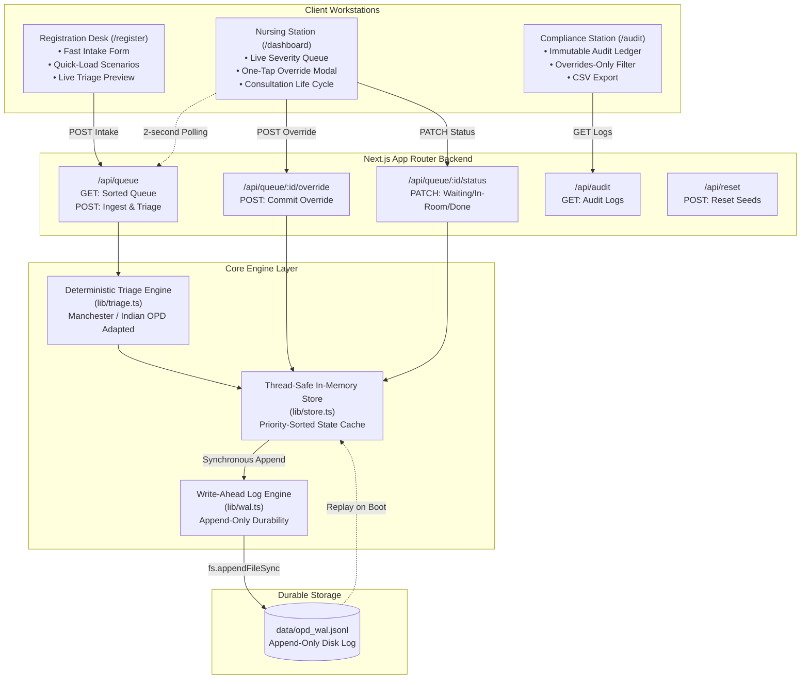
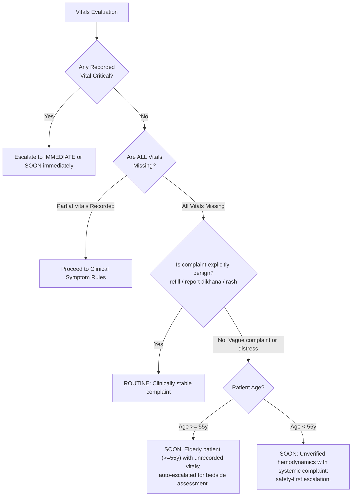

# OPD Flow: Clinical Architecture & Technical Specification
**Aayu 2026 AI Medical Hackathon — Track 01 ("OPD Flow")**  
*Dr. S.N. Medical College & Associated Hospitals, Jodhpur*

---

## 1. Executive Summary & Clinical Scope

In high-volume Indian government medical college Outpatient Departments (OPDs), thousands of patients arrive daily and receive static chronological tokens (First-In, First-Out / FIFO). 

### The Fatal Flaw of Static FIFO
Under FIFO queuing, a 60-year-old patient with impending acute coronary syndrome (e.g. chest tightness, diaphoresis) arriving at 09:15 AM is forced to wait behind 80 stable patients seeking routine prescription refills or follow-ups who arrived at 08:30 AM. This delay directly precipitates unmonitored corridor arrests and clinical deterioration.

### The Problem Scope of Track 01 ("OPD Flow")
**OPD Flow** replaces static token FIFO queuing with **deterministic, explainable clinical triage** operating strictly between the registration desk and the doctor consultation room.

```
[ Patient Arrives ] 
        │
        ▼
[ Registration Desk: Token Ingestion & Optional Vitals ]
        │
        ▼
[ Deterministic Clinical Triage Rules Engine ]  <─── Zero speculative AI diagnosis
        │                                       <─── Fail-safe missing vitals escalation
        ▼
[ Dynamic Severity Queue: IMMEDIATE (Red) -> SOON (Yellow) -> ROUTINE (Green) ]
        │
        ├──▶ [ One-Tap Nurse Override with Mandatory Clinical Reason ]
        │
        ▼
[ Doctor Consultation Room ]
        │
        ▼
[ Append-Only Write-Ahead Log (WAL) & Statutory Audit Trail ]
```

### Boundary Constraints Adherence
- **NOT a Diagnostic Engine**: Does not diagnose conditions (e.g., does not diagnose "Myocardial Infarction"). Instead, it identifies clinical acuity and velocity of care (e.g., "High-Risk Acute Coronary presentation; immediate ECG and physician review mandatory").
- **NOT an Automated Re-Triage Bot**: Re-triage is clinician-led via the **One-Tap Nurse Override**, preserving physician judgment.
- **Fail-Safe Vitals**: If vitals are unrecorded or missing, the system **errs strictly on the side of caution**, auto-escalating vulnerable or elderly patients to prevent silent deterioration.

---

## 2. System Architecture & Component Flow



---

## 3. Deterministic Triage Rules Matrix

Implemented in `src/lib/triage.ts`, adapted from the Manchester Triage System and Indian National Triage protocols for OPDs:

### Tier 1: IMMEDIATE (Red Badge)
*Imminent threat to life/limb, critical organ ischemia, or respiratory collapse.*
- **SpO2 < 90%**: Critical hypoxia; immediate resuscitation protocol.
- **Pulse > 130 bpm OR < 40 bpm**: Severe hemodynamic instability; malignant arrhythmia risk.
- **Systolic BP > 200 mmHg**: Hypertensive crisis; acute cerebrovascular/end-organ risk.
- **Acute Presentation (Age > 35)**: Symptoms containing *"chest pain"*, *"chest tightness"*, *"tightness"*, *"breathless"*, *"saas lene me dikkat"*, or *"chhati me dard"*.
- **Collapse / Altered Consciousness**: *"unconscious"*, *"collapse"*, *"fainted"*, *"behosh"* (any age).

### Tier 2: SOON (Yellow Badge)
*Potential rapid deterioration, high pain, severe physiological derangement, or vulnerable patient with missing vitals.*
- **SpO2 90%–94%**: Sub-optimal oxygenation.
- **Pulse 105–130 bpm OR 45–50 bpm**: Tachycardia / marked bradycardia.
- **Systolic BP 180–200 mmHg**: Severe stage 2/3 hypertension.
- **Temperature >= 101.5°F**: High-grade pyrexia.
- **Acute Distress Symptoms**: *"abdominal pain"*, *"pet dard"*, *"severe headache"*, *"vomiting"*, *"dizziness"*, *"chakkar"*, *"fracture"*, *"active bleeding"*.
- **Cardiorespiratory complaint in young adult (Age <= 35)**: Prompts review within 30 minutes.

### Tier 3: ROUTINE (Green Badge)
*Stable vitals, minor ailments, chronic prescription refills, standard follow-up.*
- Normal physiology: SpO2 >= 95%, Pulse 60–100 bpm, SBP < 140 mmHg.
- Maintenance requests: *"routine follow up"*, *"refill"*, *"report dikhana"*, *"rash"*, dressing or stitch removal.

---

## 4. Partial & Missing Vitals Fail-Safe Engine

In high-pressure Indian OPD registration counters, time constraints or equipment shortages frequently result in unrecorded vitals. **OPD Flow treats missing data as a safety risk, never as benign**:



---

## 5. Write-Ahead Log (WAL) Database Engine

Instead of relying on heavy cloud database dependencies (which crash or introduce network latency during internet outages in hospital wards), OPD Flow uses an embedded **Write-Ahead Log (WAL)** engine (`src/lib/wal.ts`).

### How the WAL Works
1. **Append-Only File (`data/opd_wal.jsonl`)**: Every transaction is written as an immutable JSON line on disk via `fs.appendFileSync()`.
2. **Synchronous Write Guarantee**:
   $$\text{Client Request} \longrightarrow \text{Triage Evaluation} \longrightarrow \mathbf{Flush\ to\ WAL} \longrightarrow \text{Update Memory Cache} \longrightarrow \text{Respond}$$
3. **Crash Recovery & Replay**: When the Node.js server reboots, the store reads `data/opd_wal.jsonl` from line 1 to EOF. It replays all token creations, nurse overrides, and status transitions, restoring 100% of the patient state and audit sequence.
4. **Lightweight Integrity Checksum**: Every record includes a rolling hash checksum for tamper detection.

```json
{"seq":101,"timestamp":"2026-10-13T09:20:00.000Z","action":"TOKEN_ISSUED","patientId":"pat-87","tokenNumber":"87","payload":{"patientName":"Ramprasad Sharma","currentPriority":"IMMEDIATE"...},"staffBadge":"TO-108 (Triage Officer Dr. Mathur)","checksum":"4fa28b10"}
{"seq":102,"timestamp":"2026-10-13T09:25:00.000Z","action":"CLINICAL_OVERRIDE","patientId":"pat-23","tokenNumber":"23","payload":{"oldPriority":"ROUTINE","newPriority":"IMMEDIATE","justification":"Patient observed diaphoretic in corridor"},"staffBadge":"SN-402 (Staff Nurse Sunita)","checksum":"81dc9bdb"}
```

---

## 6. One-Tap Clinical Nurse Override & Compliance Trail

Automated rules can never replace experienced bedside clinical intuition. If a patient triaged as ROUTINE suddenly deteriorates in the waiting hall:

1. The nurse taps **"One-Tap Override"** on the patient card.
2. Selects the new priority (`IMMEDIATE`, `SOON`, `ROUTINE`).
3. Selects a preset clinical ground (e.g., *"Patient observed diaphoretic and pale in corridor"*) or types a custom justification.
4. The system:
   - Commits the override transaction to the WAL file.
   - Updates the patient's active priority.
   - Immediately re-sorts the queue (placing the patient at the top).
   - Generates an immutable entry in `/audit` linking the event to the active staff badge (`SN-402`).

---

## 7. Verification Proof & Demonstration Script

### Test Case 1: Token 87 vs Token 23 Priority Jump
- **Token 23** (Priya Verma, 24y): Arrived 15 minutes ago. Complaint: *"Routine thyroid refill follow-up"*. Vitals normal. **Priority: ROUTINE**.
- **Token 87** (Ramprasad Sharma, 60y): Arrived 3 minutes ago. Complaint: *"Tightness in chest, severe sweating"*. BP 155/95, Pulse 112, SpO2 93%. **Priority: IMMEDIATE**.
- **Result in Queue**:
  - `Rank #1`: **Token #87 (IMMEDIATE)**
  - `Rank #4`: **Token #23 (ROUTINE)**
  - Token 87 **jumped ahead of Token 23 by 3 positions**, proving the complete elimination of static FIFO delay.

### Test Case 2: Partial Vitals Fail-Safe
- **Token 62** (Kamla Devi, 62y): Arrived with *"Chakkar and ghabrahat"*, **no vitals recorded**.
- **Result**: Auto-escalated to **SOON (Yellow)**: `"Elderly patient (>=55y) with unrecorded vitals; auto-escalated for bedside assessment."`

### Test Case 3: One-Tap Nurse Override
- Token 23 escalated from ROUTINE to IMMEDIATE with justification: *"Patient observed diaphoretic and pale in corridor"*.
- Token 23 instantly re-sorts to **Rank #1** in the live queue.
- Audit entry logged under sequence `#115` with badge `SN-402`.

---

## 8. Containerization & Deployment (Docker & Compose)

OPD Flow is containerized with a lightweight multi-stage Docker build producing a standalone Next.js image.

### Running with Docker Compose
```bash
docker compose up --build
```
- **Port**: Exposed on port `3000` (`http://localhost:3000`).
- **Data Persistence**: Host volume `./data:/app/data` ensures that the append-only Write-Ahead Log (`data/opd_wal.jsonl`) survives container restarts and upgrades.
- **Health Check**: Automated periodic probe pinging `/api/queue` to verify server responsiveness.
