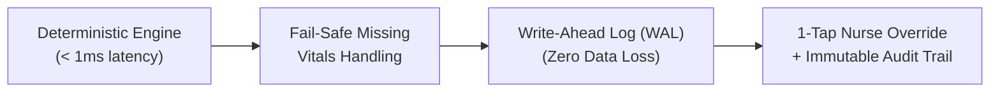

# Triage: Presentation Cheat Sheet (Rules & Technical Approach)

> **Quick Slide-by-Slide Guide for Pitching / PPT Presentation**  
> Use this document to craft punchy presentation slides and deliver crisp, confident answers during judge Q&A.

---

## 🎯 1. The 30-Second Elevator Pitch (Slide 1: Hook)

> *"In busy outpatient hospitals, patients are treated on a first-come, first-served basis (FIFO). If a 60-year-old having a silent heart attack arrives 15 minutes after a young person needing a thyroid refill, the heart attack patient waits 90 minutes in a corridor. **Triage** replaces dumb FIFO ticketing with an **instant, explainable clinical triage engine** between the registration desk and the doctor. Critical patients jump straight to the top, partial vitals are handled with safety-first escalations, and nurses can override priorities with 1 tap."*

---

## 📋 2. The Clinical Triage Rules Matrix (Slide 2 & 3: Clinical Logic)

Our triage engine uses **deterministic clinical decision rules** adapted from the Manchester Triage System and Indian National Health Mission (NHM) OPD guidelines:

### 🔴 IMMEDIATE (Red — Top Priority / Immediate Physician Attention)
* **Physiological Red Lines**:
  * **Critical Hypoxia**: Oxygen Saturation (`SpO2`) < 90% (Imminent respiratory failure).
  * **Hemodynamic Instability**: Pulse < 40 bpm or > 130 bpm (Cardiogenic shock / malignant arrhythmia).
  * **Hypertensive Crisis**: Systolic BP > 200 mmHg (Immediate stroke/organ failure risk).
* **Clinical Red Flags**:
  * **Acute Coronary / Respiratory Syndrome**: Chest tightness, chest pain, or breathlessness in any patient **> 35 years old**.
  * **Neurological / Airway Emergency**: Unconsciousness, fainting, collapse, or active convulsions.

### 🟡 SOON (Amber — Priority Queue / Review within 30 Minutes)
* **Borderline Physiological Numbers**:
  * SpO2: 90% – 94% (Sub-optimal oxygen).
  * Pulse: 110 – 130 bpm (Tachycardia) or 45 – 54 bpm.
  * Systolic BP: 170 – 200 mmHg (Severe hypertension).
  * Pyrexia: High fever > 101.5°F.
* **Acute Presentations**: Severe abdominal pain (*pet dard*), persistent vomiting, uncontrolled bleeding, deep trauma.
* **Fail-Safe Missing Vitals**:
  * Any patient **≥ 55 years old** with unrecorded vitals and vague systemic symptoms (*ghabrahat*, *chakkar*, *kamzori*).
  * **Rule**: *Missing vitals are treated as a safety risk, NEVER as healthy.*

### 🟢 ROUTINE (Green — Standard Queue)
* Vitals within normal physiological limits.
* Complaints: Routine medication refills, follow-up lab reviews, minor rashes, suture removals, stable chronic symptoms.

---

## ⚙️ 3. Technical Approach & Architecture (Slide 4 & 5: Tech Stack)

### A. Core Stack
* **Framework**: Next.js 16 (App Router) + React 19 + TypeScript (strict mode, zero `any`).
* **Styling**: Tailwind CSS (Minimal, high-contrast white healthcare theme).
* **Execution Environment**: Node.js 20 / 24, containerized with multi-stage Alpine Docker.

### B. The 4 Technical Pillars (Why This is Production-Grade)

1. **Deterministic Rule Engine (No Black-Box LLMs)**:
   * **Why not an LLM?** Generative AI introduces hallucination risks, non-deterministic outputs, and multi-second latency.
   * **Our Solution**: Pure deterministic TypeScript rules that run in **< 1 millisecond**, are 100% testable (10/10 automated tests passing), and produce plain-language clinical reasons for every decision.
2. **Fail-Safe Missing Vitals (Safety Escalation)**:
   * Real OPDs are chaotic; registration clerks often cannot record BP or pulse.
   * Naive software marks patients "Routine". Triage detects missing vitals in high-risk groups (elderly, acute symptoms) and **auto-escalates them to SOON** for bedside nursing triage.
3. **Write-Ahead Log (WAL) Durability**:
   * **Why not heavy cloud databases?** Hospital internet frequently drops or encounters network latency.
   * **Our Solution**: An embedded, append-only **Write-Ahead Log** (`data/opd_wal.jsonl`). Every token creation, override, and status change is written to disk with a cryptographic checksum before memory updates. Resilient to power loss and zero external cloud dependencies.
4. **1-Tap Nurse Override & Immutable Audit Trail**:
   * A nurse in the hallway who spots a patient looking pale or sweating cold can upgrade or downgrade their priority with a single click.
   * The queue re-sorts instantly, and an immutable log records the staff badge, timestamp, and clinical justification.

---

## 🎤 4. PPT Presentation Script (What Your Teammate Should Say)

### Slide 1: The Problem
> *"In almost every hospital OPD in India, token systems are blind FIFO queues. Token 87 is a 60-year-old with chest tightness sitting quietly. Token 23 is a young student collecting a routine thyroid refill. The system gives Token 23 priority simply because she walked in first. He waits 90 minutes. That delay costs lives."*

### Slide 2: The Solution (Triage)
> *"We built **Triage**: an explainable, deterministic patient prioritization system operating directly between the registration desk and the doctor. It takes symptoms and basic vitals at registration, calculates priority in under 1 millisecond, and automatically rearranges the doctor's queue."*

### Slide 3: The Clinical Rules
> *"We classify patients into three clear tiers: Immediate, Soon, and Routine. If a patient is over 35 with chest pain, or has oxygen below 90%, they instantly become IMMEDIATE. If an elderly person arrives with dizziness and the desk was too busy to take their vitals, our fail-safe engine auto-escalates them to SOON so they don't get lost in the crowd."*

### Slide 4: Real-World Resilience (WAL + Nurse Override)
> *"We designed this for real government hospital conditions:
> 1. No internet? No problem. Our Write-Ahead Log stores transactions locally on disk with zero cloud failure points.
> 2. Clinical oversight? A nurse can visually spot deterioration and override priority in 1 tap with full audit logging."*

---

## 💡 5. Rapid-Fire Judge Q&A Cheat Sheet

| Question | Winning Response |
| :--- | :--- |
| **"Why didn't you use an AI/LLM for triage?"** | *"In acute medical triage, consistency and sub-second speed are critical. LLMs can hallucinate, are non-deterministic, and take 2-4 seconds. Our engine runs in under 1 millisecond, is 100% reproducible, explainable to non-technical doctors, and fully audited."* |
| **"What happens when the registration desk doesn't record vitals?"** | *"That is our Fail-Safe feature. Instead of naively assuming the patient is fine, our engine treats unrecorded vitals in high-risk categories (elderly or acute systemic complaints) as a safety risk and auto-escalates them to SOON."* |
| **"How does the doctor know a patient was moved up?"** | *"Patients in the queue are strictly ordered by priority (IMMEDIATE first). Overridden patients feature an explicit badge, and both the doctor and hospital administrators can view the complete clinical rationale and audit trail."* |
| **"What database are you using?"** | *"An append-only Write-Ahead Log (WAL). It provides ACID-like crash durability on the local filesystem with zero cloud latency or database connection drops."* |
